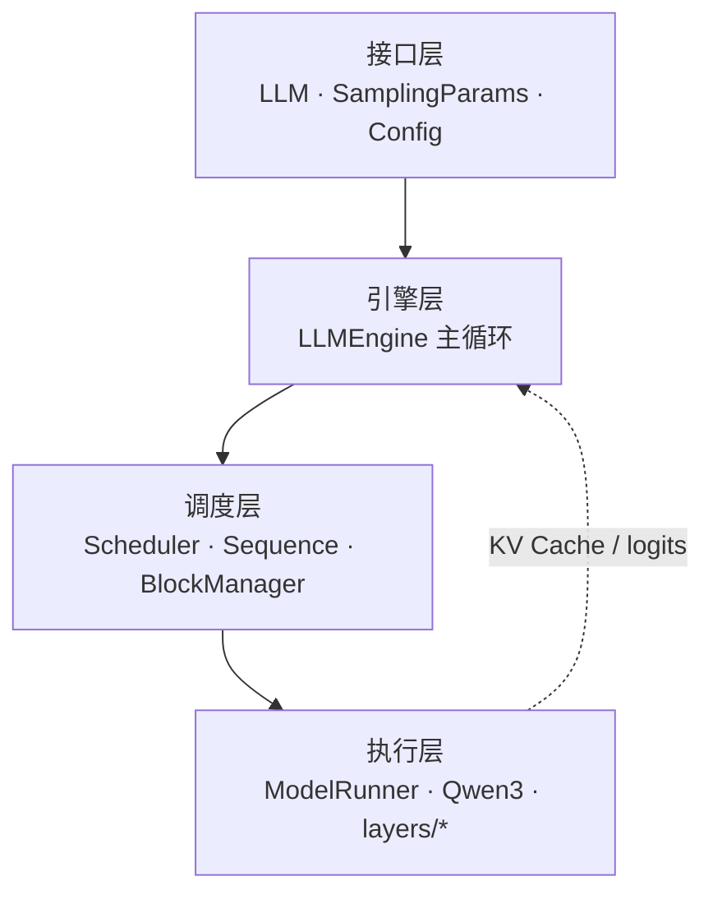
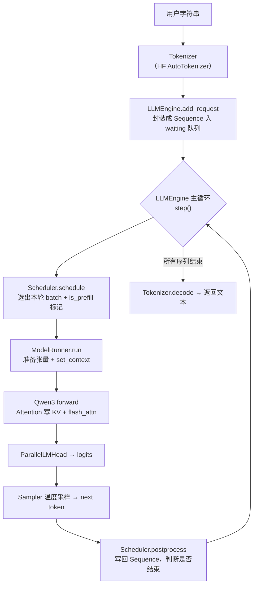

## 📑 目录

- [1. 为什么值得读 nano-vllm](#1-为什么值得读-nano-vllm)
- [2. 目录结构速览](#2-目录结构速览)
- [3. 四层架构](#3-四层架构)
- [4. 一个请求的生命周期](#4-一个请求的生命周期)
- [5. 与 vLLM 的关系](#5-与-vllm-的关系)
- [总结](#-总结)
- [自我检验清单](#-自我检验清单)
- [参考资料](#-参考资料)

---

## 1. 为什么值得读 nano-vllm

学推理引擎最大的拦路虎，是 vLLM、SGLang 这类生产框架动辄十几万行代码——你知道它快，却很难指着某一行说「批处理就是在这里拼起来的」。**nano-vllm** 把这件事变简单了：它用约 1200 行 Python，把一个推理引擎该有的主干全部实现了一遍。

[nano-vllm GitHub 仓库](https://github.com/GeeeekExplorer/nano-vllm)

打个比方，如果说 vLLM 是一座有地下管网、消防系统、电梯调度的摩天大楼，那 nano-vllm 就是一栋结构裸露的样板房——墙体、承重柱、水电走线一清二楚，你能一眼看明白「房子是怎么立起来的」。它刻意不做生产环境需要的那些边角料（海量模型适配、量化方案全家桶、分布式集群编排），只保留**算法与工程主干**。

| 📊 维度 | 📝 说明 |
|---------|---------|
| 作者 | Xingkai Yu（GitHub `GeeeekExplorer`），DeepSeek 工程师、南京大学 |
| 代码量 | 约 1200 行 Python（核心包 `nanovllm/`） |
| 协议 / 热度 | MIT；截至 2026-10 约 15.8k stars |
| 示例模型 | `Qwen/Qwen3-0.6B`（接口对齐 vLLM） |
| 优化套件 | 前缀缓存、张量并行、`torch.compile`、CUDA Graph |

它特别适合两类人：第一次系统学习推理 / Serving 的开发者，以及准备大模型推理岗、需要「能讲到源码级细节」的面试者。熟悉 nanoGPT 的读者可以这样类比：

| 🔎 项目 | 对应「完整版」 | 教学侧重点 |
|------|----------------|------------|
| nanoGPT | 大规模语言模型训练 | 训练循环、Transformer Block |
| **nano-vllm** | **vLLM 等推理引擎** | **批处理、KV 管理、调度、低延迟执行** |

你已经会写模型的 `forward`，下一步要理解的是：**batch 如何动态组装、KV 如何分块存放、何时该 prefill 何时该 decode**。nano-vllm 把这条线拉直了。

💡 **提示**：读源码前，强烈建议先过一遍第 2 章。本章不再重复 PagedAttention、Continuous Batching 这些概念的「是什么」，而是直接看它们在代码里「长什么样」。

## 2. 目录结构速览

把仓库 clone 下来，核心代码都在 `nanovllm/` 包里。先建立「文件名 → 职责」的映射，后面读到哪个模块都能对号入座：

```text
nanovllm/
├── __init__.py          # 对外导出 LLM, SamplingParams
├── config.py            # Config 全局配置（dataclass）
├── llm.py               # LLM：对 LLMEngine 的薄封装
├── sampling_params.py   # SamplingParams 采样超参
├── engine/
│   ├── llm_engine.py    # 引擎主循环：调度 → 前向 → 采样 → 更新
│   ├── scheduler.py     # Prefill/Decode 调度与抢占
│   ├── sequence.py      # 单条请求的状态机
│   ├── block_manager.py # KV Cache 的分块分配与回收
│   └── model_runner.py  # GPU 侧执行：张量准备、Context、CUDA Graph
├── layers/
│   ├── attention.py     # Triton 写 KV + FlashAttention 前向
│   ├── linear.py        # 列/行/QKV/合并 并行 Linear
│   ├── embed_head.py    # 词表并行 Embedding 与 LMHead
│   ├── layernorm.py     # RMSNorm
│   ├── activation.py    # SiluAndMul（SwiGLU）
│   ├── rotary_embedding.py  # RoPE 旋转位置编码
│   └── sampler.py       # 温度采样
├── models/
│   └── qwen3.py         # Qwen3 模型实现
└── utils/
    ├── context.py       # 全局推理上下文（is_prefill、cu_seqlens 等）
    └── loader.py        # safetensors 权重加载
```

目录本身就在讲故事：`engine/` 是「大脑」（决定做什么、怎么调度），`layers/` 和 `models/` 是「肌肉」（真正做矩阵运算），`utils/` 是「神经」（跨模块传递上下文与加载权重）。而最外层的 `__init__.py` 只导出两个名字——`LLM` 和 `SamplingParams`，这也是用户唯一需要关心的两个入口。

## 3. 四层架构

把这些文件按「谁调用谁」归类，会得到一个非常清爽的四层结构。理解了这张图，整个项目就从「一堆文件」变成了「一条有方向的调用链」。



**🔌 第一层：接口层（`llm.py` + `sampling_params.py` + `config.py`）**

用户只接触 `LLM`（提供 `generate`）和 `SamplingParams`（温度、最大长度等）。`Config` 则在引擎初始化时一次性把显存比例、最大批大小、张量并行度、KV 块大小等全局约束固化下来。这一层的设计哲学是**对外 API 最小化**——你不需要懂调度就能跑通推理。

**🧠 第二层：引擎层（`engine/llm_engine.py`）**

`LLMEngine` 是整个系统的「业务逻辑心脏」。它持有调度器、模型执行器和分词器，跑一个循环：**从调度器拿一批可执行的序列 → 交给执行器做一次前向 → 采样出下一个 token → 更新序列状态**，直到所有请求结束。

**🗂️ 第三层：调度层（`scheduler.py` + `sequence.py` + `block_manager.py`）**

这一层回答「这一步该跑谁、它们的 KV 放哪儿」。`Scheduler` 决定本轮是 prefill 还是 decode、把哪些序列拼成一个 batch；`Sequence` 跟踪每条请求的 token、步数、是否结束；`BlockManager` 用 PagedAttention 的思想给 KV 分配物理块。注意：**它只管资源分配与生命周期，不碰矩阵乘法**——这也是它属于调度层而非 `layers/` 的原因。

**⚙️ 第四层：执行层（`model_runner.py` + `models/qwen3.py` + `layers/*`）**

`ModelRunner` 把调度器选出的序列「张量化」：构造 `input_ids`、`positions`、`slot_mapping`、`block_tables` 等张量，设置全局 `Context`，然后调用 `Qwen3` 前向。`layers/` 是算子级实现，其中 `attention.py` 身兼两职——既负责把新的 K/V 写进 Cache，又负责调用 FlashAttention 做注意力计算。

| 模块 | 一句话职责 |
|------|------------|
| `config.py` | 全局超参，与 HuggingFace 配置对齐 |
| `llm.py` | 对外 `generate`，内部转交 `LLMEngine` |
| `llm_engine.py` | 推理主循环：调度 → 前向 → 采样 → 更新 |
| `scheduler.py` | 选序列、组 batch、Prefill/Decode 策略、抢占 |
| `sequence.py` | 单请求状态机 |
| `block_manager.py` | KV 块分配、回收与前缀缓存 |
| `model_runner.py` | GPU 侧执行、Context 注入、CUDA Graph |
| `attention.py` | Triton 写 KV + FlashAttention 两条路径 |
| `qwen3.py` | Transformer 层堆叠与权重映射 |

## 4. 一个请求的生命周期

光看分层还不够，真正把代码「串」起来的是数据流。下面这张图描述了一个字符串从进入到吐出完整文本的全过程——后续每一节其实都是在放大这条链路的某一段。



用一段话复述（这也是面试里高频的「请求进来之后代码路径」题）：

1. 📥 业务脚本用 HuggingFace 分词器把 prompt 编码成 token id，调用 `llm.generate`。
2. `LLMEngine` 为每条 prompt 创建一个 `Sequence`，交给 `Scheduler` 的等待队列。
3. ⚙️ 主循环每执行一次 `step()`：`Scheduler` 根据 Token Budget 和 KV 余量选出本轮要跑的序列，并标记这是一次 **prefill**（处理 prompt）还是 **decode**（逐 token 生成）。
4. `ModelRunner` 把这批序列转成 GPU 张量，写好全局 `Context`，跑一遍 `Qwen3`。前向过程中 `Attention` 把新算出的 K/V 存进 KV Cache，再用 FlashAttention 算注意力。
5. 模型输出的 hidden state 过 `ParallelLMHead` 得到 logits，`Sampler` 按温度采样出下一个 token。
6. `Scheduler.postprocess` 把新 token 写回对应 `Sequence`，判断是否命中 EOS 或达到 `max_tokens`——结束的序列释放 KV 块，未结束的留到下一轮 decode。
7. 📤 所有序列结束后，按请求顺序解码成字符串返回。

📌 **关键点**：**Prefill 和 Decode 不混在同一个 batch 里**（这一点与早期 vLLM 一致）。prefill 一次吃掉整段 prompt、是算力密集型；decode 每条序列每步只算一个 token、是访存密集型。调度器用「这一轮要么全 prefill、要么全 decode」的策略把两种负载分开，这是理解 `Scheduler` 的前提，3.5 会详细展开。

## 5. 与 vLLM 的关系

面试里经常被问「nano-vllm 和 vLLM 什么关系」。标准答法是：**思想同源，工程裁剪**。

| 维度 | nano-vllm | vLLM |
|------|-----------|------|
| 代码量 | 约 1200 行，单仓库可通读 | 十万行量级、多模块 |
| 核心思想 | 分块 KV、连续批处理、FlashAttention、张量并行 | 同类思想 + 更完整的生产特性 |
| 功能覆盖 | Qwen3 路径 + 教学向最小闭环 | 多模型生态、量化、API Server、分布式 |
| 定位 | 学习、面试、二次实验 | 生产 Serving |

✅ **推荐表述**：nano-vllm 不是用来替代 vLLM 上生产，而是把 vLLM 的主干算法与工程路径压缩到「可读范围」。它继承了 PagedAttention、Continuous Batching、FlashAttention、TP 等核心机制，省略的是量化、海量模型适配、集群编排这些工程细节。

❌ **不要这样说**：「nano-vllm 比 vLLM 落后 / 简陋」——这混淆了教学项目与生产系统的定位，是面试减分项。

## 📝 总结

- nano-vllm 用约 1200 行 Python 实现了一个推理引擎的完整主干，是读懂 vLLM 类系统的理想样本。
- 代码按**接口层 → 引擎层 → 调度层 → 执行层**四层组织，调用方向自上而下，KV Cache 与 logits 自下而上回流。
- 一个请求的生命周期是一条清晰的流水线：分词 → 入队 → 调度 → 张量化 → 前向（写 KV + 注意力）→ 采样 → 写回 → 解码。
- Prefill 与 Decode 分批调度，是后续理解调度器的关键前提。

## 🎯 自我检验清单

- 能说出 nano-vllm 的作者、代码量级与定位，并用一句话讲清它与 vLLM 的关系
- 能默写 `nanovllm/` 的目录结构，并说明 `engine/`、`layers/`、`utils/` 各自的职责
- 能画出接口层 / 引擎层 / 调度层 / 执行层的四层调用关系
- 能用一段话复述一个请求从字符串到输出文本的完整数据流
- 能解释为什么 `BlockManager` 属于调度层而不是 `layers/`
- 能说明 Prefill 与 Decode 为什么分开调度，以及它们各自的资源瓶颈

## 📚 参考资料

- [nano-vllm GitHub 仓库](https://github.com/GeeeekExplorer/nano-vllm)
- [nanoGPT GitHub 仓库](https://github.com/karpathy/nanoGPT)
- [Efficient Memory Management for Large Language Model Serving with PagedAttention（Kwon et al., 2023）](https://arxiv.org/abs/2309.06180)
- [vLLM 官方文档 - 架构概览](https://docs.vllm.ai/en/stable/design/arch_overview.html)
