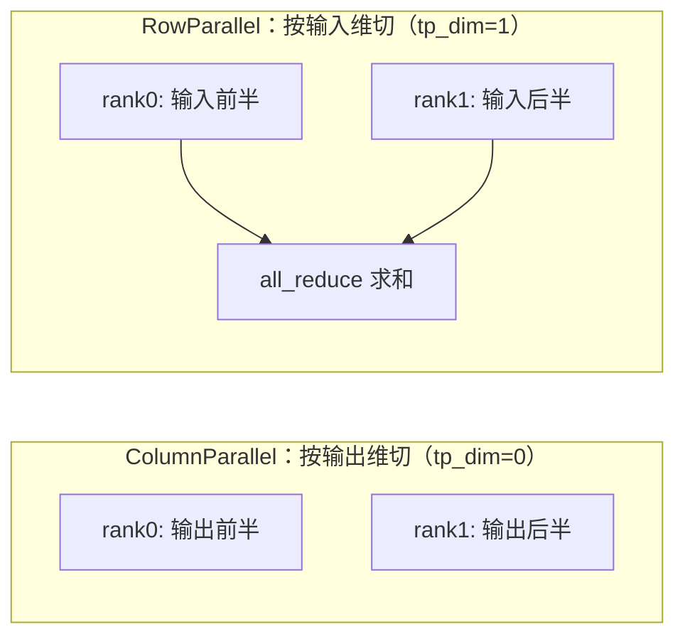

## 📑 目录

- [1. 从 Qwen3 的一层说起](#1-从-qwen3-的一层说起)
- [2. RMSNorm：更省的归一化](#2-rmsnorm更省的归一化)
- [3. RoPE：旋转位置编码](#3-rope旋转位置编码)
- [4. SwiGLU：SiluAndMul](#4-swiglusiluandmul)
- [5. 并行 Linear 族与张量并行](#5-并行-linear-族与张量并行)
- [6. 词表并行 Embedding 与 LMHead](#6-词表并行-embedding-与-lmhead)
- [7. Attention：写 KV 与两条路径](#7-attention写-kv-与两条路径)
- [8. Qwen3 的组装](#8-qwen3-的组装)
- [总结](#-总结)
- [自我检验清单](#-自我检验清单)
- [参考资料](#-参考资料)

---

## 1. 从 Qwen3 的一层说起

执行层最终要跑的是 `models/qwen3.py` 里的 Transformer。与其一上来堆算子，不如先看一个 `Qwen3DecoderLayer` 长什么样——它决定了各个算子以什么顺序被调用。

Qwen3 用的是 **Pre-Norm + 残差**结构：归一化放在子层之前，残差直接跨过子层。nano-vllm 把残差做成了「在 norm 内部融合」的写法：

```python
class Qwen3DecoderLayer(nn.Module):
    def forward(self, positions, hidden_states, residual):
        if residual is None:                       # 第一层：残差从输入初始化
            hidden_states, residual = self.input_layernorm(hidden_states), hidden_states
        else:                                       # 后续层：norm 同时吐出新残差
            hidden_states, residual = self.input_layernorm(hidden_states, residual)
        hidden_states = self.self_attn(positions, hidden_states)
        hidden_states, residual = self.post_attention_layernorm(hidden_states, residual)
        hidden_states = self.mlp(hidden_states)
        return hidden_states, residual
```

读法：每一层做两件事——**先归一化 + 注意力，再归一化 + MLP**，残差 `residual` 像一根贯穿始终的主干被一路传下去。`RMSNorm` 被设计成可以「接收上一层的残差、顺手把它加进来并返回新残差」，省去了在 `DecoderLayer` 里反复写 `x = x + sublayer(norm(x))` 的样板。下面我们把这一层用到的算子逐个展开。

## 2. RMSNorm：更省的归一化

LLM 普遍用 RMSNorm 替代 LayerNorm——去掉了减均值和偏置，只按均方根缩放，更快且效果相当。核心计算就一行：

$$
\text{RMSNorm}(x) = \frac{x}{\sqrt{\frac{1}{d}\sum_{i=1}^{d} x_i^2 + \epsilon}} \cdot \gamma
$$

nano-vllm 的 `RMSNorm` 提供两个入口。普通归一化：

```python
def rms_forward(self, x):
    var = x.float().pow(2).mean(dim=-1, keepdim=True)
    x = x * torch.rsqrt(var + self.eps)
    return (x * self.weight).to(dtype)
```

带残差相加的「融合」版本——先把残差加进来，再归一化，并把相加后的结果作为**新残差**返回：

```python
def add_rms_forward(self, x, residual):
    x = x + residual          # 融合残差相加
    residual = x              # 新残差 = 相加后的值
    # ...对 x 做 RMSNorm...
    return x, residual
```

💡 **提示**：这正是上一节 `DecoderLayer` 里 `hidden_states, residual = self.input_layernorm(hidden_states, residual)` 的来源。把「残差相加」塞进 norm，既减少一次 kernel 启动，也让主干代码更干净。中间统一用 `float()` 计算再 cast 回原精度，是为了数值稳定。

## 3. RoPE：旋转位置编码

RoPE（Rotary Position Embedding）不往输入里加位置向量，而是**按位置把 Q、K 的每一对维度旋转一个角度**，让注意力分数天然带上相对位置信息。频率表在初始化时预计算：

```python
inv_freq = 1.0 / (base ** (torch.arange(0, rotary_dim, 2).float() / rotary_dim))
t = torch.arange(max_position_embeddings).float()
freqs = torch.einsum("i,j->ij", t, inv_freq)       # [位置, 频率]
cos, sin = freqs.cos(), freqs.sin()
```

前向时把最后一维拆成两半 $(x_1, x_2)$，做一次二维旋转：

$$
\begin{aligned}
y_1 &= x_1 \cos\theta - x_2 \sin\theta \\
y_2 &= x_2 \cos\theta + x_1 \sin\theta
\end{aligned}
$$

```python
@torch.compile
def forward(self, positions, query, key):
    cos, sin = self.cos[positions], self.sin[positions]
    query = apply_rotary_emb(query, cos, sin)
    key = apply_rotary_emb(key, cos, sin)
    return query, key
```

两个值得注意的点：

- 🔑 RoPE 只作用于 **Q 和 K**，不碰 V——因为位置信息只需要体现在「谁和谁的相关性」上。
- 🔑 `forward` 带了 `@torch.compile`。RoPE 是逐元素的小算子，`torch.compile` 能把它融合成一个 kernel，减少访存往返。nano-vllm 在几处「小而频繁」的逐元素算子上都用了 `torch.compile`：RMSNorm、RoPE、SiluAndMul 和 Sampler。
- 代码里即使传入 `rope_scaling`，也只从中取出 `rope_theta`，并未实现 NTK / YaRN 等长度外推逻辑——保持最小实现。

## 4. SwiGLU：SiluAndMul

Qwen3 的 FFN 用的是 SwiGLU 激活。它把输入投影成两份——一份当「门控」过 SiLU，一份当「数据」，再逐元素相乘：

$$
\text{SwiGLU}(x) = \text{SiLU}(x W_{\text{gate}}) \odot (x W_{\text{up}})
$$

nano-vllm 把它拆成两部分：投影由一个 `MergedColumnParallelLinear` 一次算出 `gate` 和 `up` 两段（输出维是中间维的 2 倍），激活则是极简的 `SiluAndMul`：

```python
class SiluAndMul(nn.Module):
    def forward(self, x):
        gate, up = x.chunk(2, dim=-1)      # 一刀切成两半
        return F.silu(gate) * up
```

💡 **提示**：为什么要把 gate 和 up 合并成一个 Linear 再切？因为两次独立的小矩阵乘，不如一次大矩阵乘对 GPU 友好——合并后 GEMM 规模更大、访存更连续，这是推理里常见的「算子融合」套路。

## 5. 并行 Linear 族与张量并行

张量并行（Tensor Parallelism, TP）是把一个大矩阵乘切到多张卡上并行算。nano-vllm 的 `linear.py` 把这套机制封装成一组 Linear 子类，模型代码只要「选对类型」就自动具备 TP 能力。关键是分清**沿哪个维度切**：



- **`ColumnParallelLinear`（`tp_dim=0`）**：按**输出维**切分，每张卡算出一部分输出列。权重加载时用 `narrow` 沿 dim 0 取本 rank 的分片；前向是普通 `F.linear`，**不需要通信**。
- **`RowParallelLinear`（`tp_dim=1`）**：按**输入维**切分，每张卡拿输入的一部分、算出「部分和」。所以它的前向末尾必须 `dist.all_reduce(y)` 把各卡结果加起来；偏置只在 rank 0 加（避免重复累加）。
- **`QKVParallelLinear`（ColumnParallel 的子类）**：把 Q、K、V 三个投影合并成一个大矩阵，输出维是 `(num_heads + 2 * num_kv_heads) * head_dim`。它的权重加载按**字符串** `shard_id`（`"q"`/`"k"`/`"v"`）定位各段的偏移。
- **`MergedColumnParallelLinear`（ColumnParallel 的子类）**：把 gate、up 合并（上一节的 SwiGLU 用它），权重加载按**整数** `shard_id`（0=gate、1=up）索引 `output_sizes`。

把它们按 Transformer 的数据流串起来，会发现一个漂亮的配对：

| 位置 | 用什么 | 为什么 |
|------|--------|--------|
| QKV 投影 | `QKVParallelLinear`（Column） | 按头切分，每卡算自己负责的那些注意力头 |
| Attention 输出投影 `o_proj` | `RowParallelLinear` | 把各卡的头拼回来，需要 all_reduce |
| FFN 第一层 `gate_up` | `MergedColumnParallelLinear`（Column） | 按中间维切 |
| FFN 第二层 `down` | `RowParallelLinear` | 收回中间维，需要 all_reduce |

📌 **关键点**：**Column 切输出、Row 收输入**，一前一后配对，刚好让中间的激活在卡内保持切分状态、不必通信，只在每个子层的末尾做一次 all_reduce。所以每个 Transformer 层恰好有 **2 次 all_reduce**（Attention 的 `o_proj` 一次、FFN 的 `down_proj` 一次）。这正是 Megatron-LM 提出的经典 TP 切分方式，nano-vllm 用几十行代码把它复刻了出来。

## 6. 词表并行 Embedding 与 LMHead

词表（vocabulary）通常有十几万行，Embedding 和 LMHead 的权重都很大，也要切。nano-vllm 把它们做成**词表并行**：每张卡只持有词表的一段。

`VocabParallelEmbedding` 的 forward 要处理「某个 token 不属于本卡」的情况：

```python
def forward(self, x):
    mask = (x >= self.vocab_start_idx) & (x < self.vocab_end_idx)  # 本卡负责的 token
    x = mask * (x - self.vocab_start_idx)       # 平移到本地下标，越界的先置 0
    y = F.embedding(x, self.weight)
    y = mask.unsqueeze(1) * y                   # 不属于本卡的行清零
    dist.all_reduce(y)                          # 求和：每个 token 的向量只有一卡非零
    return y
```

思路很巧：每张卡都查一次，但只有「负责该 token 的卡」查出非零向量，其余卡输出 0，`all_reduce` 一加就得到完整结果。

`ParallelLMHead` 是它的子类，负责把 hidden state 投影成词表 logits。两个细节：

```python
def forward(self, x):
    context = get_context()
    if context.is_prefill:
        last_indices = context.cu_seqlens_q[1:] - 1   # 每条序列最后一个位置
        x = x[last_indices].contiguous()               # 只取最后一个 token
    logits = F.linear(x, self.weight)
    if self.tp_size > 1:
        # 各卡算出词表的一段，gather 到 rank0 再拼接成完整 logits
        all_logits = [...] if self.tp_rank == 0 else None
        dist.gather(logits, all_logits, 0)
        logits = torch.cat(all_logits, -1) if self.tp_rank == 0 else None
    return logits
```

- 🔑 **prefill 只取最后一个 token**：生成下一个 token 只需要序列最后一个位置的 logits，前面所有位置的 logits 都用不上。`cu_seqlens_q[1:] - 1` 精确定位每条序列的末位，避免把整段 prompt 都投影到词表维度——这是一个很实在的省算。
- 🔑 **LMHead 用 `gather` 而非 `all_reduce`**：因为词表是按**输出维**切的（每卡算不同的 logits 列），要的是「拼接」而不是「求和」，所以用 `dist.gather` 收到 rank 0 再 `cat`。对比上面 Embedding 用 `all_reduce`——**切输入维就 reduce，切输出维就 gather**，和第 5 节的 Column/Row 规律是同一个道理。

## 7. Attention：写 KV 与两条路径

`attention.py` 是执行层最硬核的一块，它身兼两职：**先把新算出的 K/V 写进 KV Cache，再做注意力计算**。而注意力计算在 prefill 和 decode 两个阶段走的是**不同的 FlashAttention 内核**。

### 7.1 用 Triton 把 K/V 写进 Cache

每个 token 的 K/V 要存到 KV Cache 里它该在的「槽位」（slot）。slot 的位置由上层算好的 `slot_mapping` 给出（见 3.6），这里只负责「按图索骥地写」。nano-vllm 用一个极简的 Triton kernel 完成：

```python
@triton.jit
def store_kvcache_kernel(key_ptr, key_stride, value_ptr, value_stride,
                         k_cache_ptr, v_cache_ptr, slot_mapping_ptr, D: tl.constexpr):
    idx = tl.program_id(0)                 # 每个 program 处理一个 token
    slot = tl.load(slot_mapping_ptr + idx)
    if slot == -1:                         # -1 表示这个 token 不需要写（padding）
        return
    # 用传入的 stride 定位第 idx 个 token 的 D 个元素，写到 cache 的 slot 行
    key = tl.load(key_ptr + idx * key_stride + tl.arange(0, D))
    value = tl.load(value_ptr + idx * value_stride + tl.arange(0, D))
    cache_offsets = slot * D + tl.arange(0, D)
    tl.store(k_cache_ptr + cache_offsets, key)
    tl.store(v_cache_ptr + cache_offsets, value)
```

其中 `D = num_heads * head_dim`，`key_stride`/`value_stride` 由外层用 `key.stride(0)` 传入（`store_kvcache` 包装函数还会断言 `key.stride(-1) == 1`、`k_cache.stride(1) == D` 等，确保内存布局连续）。

💡 **提示**：为什么要专门写个 Triton kernel，而不是用 PyTorch 的高级索引 `k_cache[slot_mapping] = key`？因为 KV Cache 是分块的、slot 是离散跳跃的，PyTorch 的 gather/scatter 会产生额外的中间张量和访存。一个定制 kernel 直接「一个线程写一个 token」，最省。`slot == -1` 的判断用来跳过 CUDA Graph 场景下的 padding 位置（3.6 会讲为什么 decode 要 padding）。

### 7.2 两条路径：prefill 用 varlen，decode 用 with_kvcache

`Attention.forward` 先调用 `store_kvcache` 写缓存，然后按 `context.is_prefill` 分流：

```python
def forward(self, q, k, v):
    context = get_context()
    k_cache, v_cache = self.k_cache, self.v_cache
    if k_cache.numel() and v_cache.numel():    # cache 已分配才写
        store_kvcache(k, v, k_cache, v_cache, context.slot_mapping)
    if context.is_prefill:
        if context.block_tables is not None:   # 命中前缀缓存：改从整块 cache 读历史 K/V
            k, v = k_cache, v_cache
        o = flash_attn_varlen_func(
            q, k, v,
            cu_seqlens_q=context.cu_seqlens_q, cu_seqlens_k=context.cu_seqlens_k,
            max_seqlen_q=context.max_seqlen_q, max_seqlen_k=context.max_seqlen_k,
            softmax_scale=self.scale, causal=True,
            block_table=context.block_tables)
    else:                                       # decode
        o = flash_attn_with_kvcache(
            q.unsqueeze(1), k_cache, v_cache,
            cache_seqlens=context.context_lens, block_table=context.block_tables,
            softmax_scale=self.scale, causal=True)
    return o
```

两条路径的差异正好对应两个阶段的特点：

- 🔑 **prefill 用 `flash_attn_varlen_func`**：一次要算整段 prompt 的注意力，多条序列**变长**地拼在一起（靠 `cu_seqlens` 累积长度切分），`causal=True` 保证每个位置只看前文。当本步命中了前缀缓存（`block_tables is not None`），`k, v` 会被整块替换为 `k_cache`/`v_cache`，再借 `block_table` 索引物理块，把已缓存的历史 K/V 一并纳入注意力。
- 🔑 **decode 用 `flash_attn_with_kvcache`**：每条序列只新增一个 token（`q.unsqueeze(1)` 补出长度维 1），K/V 全部来自 Cache，用 `cache_seqlens` 告诉 kernel 每条序列当前多长、`block_table` 告诉它去哪些物理块里读。
- 缩放因子 `scale = head_dim ** -0.5`，即标准 $1/\sqrt{d_k}$。

📌 **关键点**：这就是第 1 章「Prefill 算力密集、Decode 访存密集」在代码里的落点——两个阶段连调的 FlashAttention 内核都不一样。KV Cache 的「物理块怎么分、slot 怎么算」留到 3.4 和 3.6，这里只需记住 Attention 既是「写入方」也是「读取方」。

## 8. Qwen3 的组装

有了上面这些算子，`models/qwen3.py` 就是把它们按 Qwen3 的结构拼起来。两个和「标准 LLaMA 式」实现不同的点值得一提。

**① QKV 投影后对 Q、K 做 per-head RMSNorm**。Qwen3 在每个注意力头的 Q、K 上各加了一个 RMSNorm（即 QK-Norm），用来稳定训练：

```python
def forward(self, positions, hidden_states):
    qkv = self.qkv_proj(hidden_states)
    q, k, v = qkv.split([self.q_size, self.kv_size, self.kv_size], dim=-1)
    q = q.view(-1, self.num_heads, self.head_dim)     # reshape 成 [token, 头, head_dim]
    k = k.view(-1, self.num_kv_heads, self.head_dim)
    v = v.view(-1, self.num_kv_heads, self.head_dim)
    if not self.qkv_bias:                             # Qwen3 走这条分支
        q = self.q_norm(q)                            # 在 head_dim 维上逐头归一化
        k = self.k_norm(k)
    q, k = self.rotary_emb(positions, q, k)           # 再加旋转位置
    o = self.attn(q, k, v)
    return self.o_proj(o.flatten(1, -1))              # 把头维摊平后投影回 hidden
```

🔑 **核心概念**：`RMSNorm` 作用在最后一维 `head_dim` 上，所以把张量 reshape 成 `[token, 头, head_dim]` 后直接送进去，天然就是「逐头」归一化。注意 QK-Norm 只在 `not self.qkv_bias`（Qwen3 的配置）时启用——这是 Qwen3 区别于带 QKV bias 的旧结构的关键开关。

**② 权重映射 `packed_modules_mapping`**。因为 nano-vllm 把 q/k/v 合并成了 `qkv_proj`、gate/up 合并成了 `gate_up_proj`，而 HuggingFace 的 checkpoint 里它们是分开的六个权重。加载时靠一张映射表把原始权重名「翻译」到合并后的目标及其 shard_id：

```python
packed_modules_mapping = {
    "q_proj":    ("qkv_proj", "q"),      # 字符串 shard_id
    "k_proj":    ("qkv_proj", "k"),
    "v_proj":    ("qkv_proj", "v"),
    "gate_proj": ("gate_up_proj", 0),    # 整数 shard_id
    "up_proj":   ("gate_up_proj", 1),
}
```

这正好解释了第 5 节「QKV 用字符串 shard_id、Merged 用整数 shard_id」的来源——两套 `weight_loader` 恰好对应这张表里的两种值类型。

此外还有两个工程细节：

- **`tie_word_embeddings`**：Qwen3-0.6B 这类小模型会把 Embedding 和 LMHead 的权重绑定（共享同一张表），加载时直接把 embed 权重拷给 lm_head，省一份显存。
- **`compute_logits` 单独调用 LMHead**：前向只算到 hidden state，logits 的计算（含上一节 LMHead 的「只取最后 token」优化）被拆到单独一步，方便和采样配合。

## 📝 总结

- `Qwen3DecoderLayer` 是 Pre-Norm + 残差结构，nano-vllm 把「残差相加」融合进 `RMSNorm`，让主干代码只传一根 `residual`。
- RMSNorm 去掉减均值、只按均方根缩放；RoPE 只旋转 Q/K 不碰 V，并用 `@torch.compile` 融合；SwiGLU 由 `MergedColumnParallelLinear` + `SiluAndMul` 实现，合并 GEMM 更省。
- 并行 Linear 族遵循「**Column 切输出、Row 收输入**」：每个 Transformer 层恰好 2 次 `all_reduce`（`o_proj` 与 `down_proj`）。
- 词表并行里，Embedding 切输入维用 `all_reduce`、LMHead 切输出维用 `gather`；LMHead 在 prefill 阶段只对每条序列最后一个 token 投影。
- Attention 先用 Triton kernel 把 K/V 写进 Cache，再按阶段分流：prefill 走 `flash_attn_varlen_func`，decode 走 `flash_attn_with_kvcache`。
- Qwen3 的特色是 per-head QK-Norm 与 `packed_modules_mapping` 权重合并映射。

## 🎯 自我检验清单

- 能画出 `Qwen3DecoderLayer` 的数据流，并解释残差为什么能融合进 RMSNorm
- 能说清 RMSNorm 相比 LayerNorm 省了什么，以及 RoPE 为什么只作用于 Q/K
- 能解释 SwiGLU 为什么把 gate、up 合并成一个 Linear 再切
- 能区分 ColumnParallelLinear 与 RowParallelLinear 的切分维度与通信方式，并说出每层为何恰好 2 次 all_reduce
- 能解释词表并行里 Embedding 用 `all_reduce`、LMHead 用 `gather` 的原因
- 能说出 Attention 在 prefill 与 decode 分别调用哪个 FlashAttention 函数，以及 Triton `store_kvcache` 的作用
- 能解释 `packed_modules_mapping` 为什么同时出现字符串和整数两种 shard_id

## 📚 参考资料

- [nano-vllm GitHub 仓库](https://github.com/GeeeekExplorer/nano-vllm)
- [RoFormer: Enhanced Transformer with Rotary Position Embedding（Su et al., 2021）](https://arxiv.org/abs/2104.09864)
- [Root Mean Square Layer Normalization（Zhang & Sennrich, 2019）](https://arxiv.org/abs/1910.07467)
- [GLU Variants Improve Transformer（Shazeer, 2020）](https://arxiv.org/abs/2002.05202)
- [Megatron-LM: Training Multi-Billion Parameter Language Models Using Model Parallelism（Shoeybi et al., 2019）](https://arxiv.org/abs/1909.08053)
- [FlashAttention: Fast and Memory-Efficient Exact Attention with IO-Awareness（Dao et al., 2022）](https://arxiv.org/abs/2205.14135)
- [Triton 官方文档](https://triton-lang.org/)
