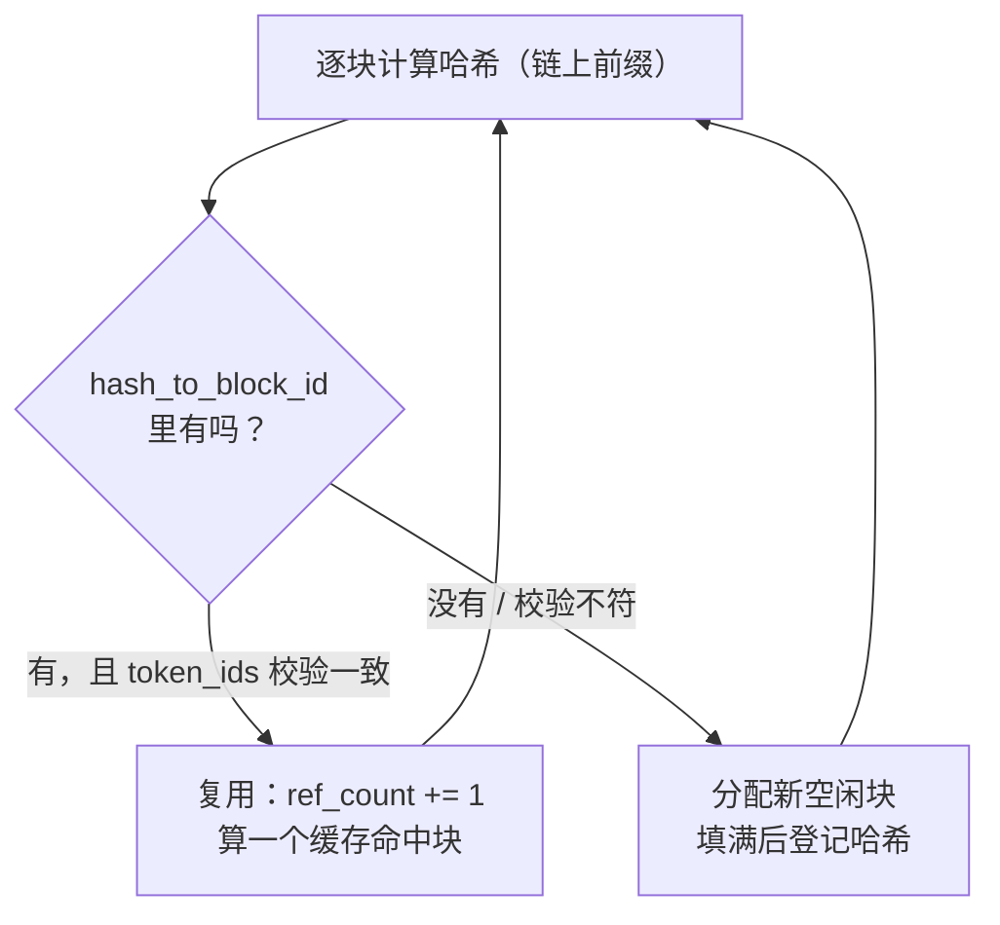

## 📑 目录

- [1. 为什么 KV 要分块](#1-为什么-kv-要分块)
- [2. Block：最小管理单元](#2-block最小管理单元)
- [3. Sequence：一条请求的状态机](#3-sequence一条请求的状态机)
- [4. BlockManager：分配、追加与回收](#4-blockmanager分配追加与回收)
- [5. 前缀缓存：用哈希复用历史](#5-前缀缓存用哈希复用历史)
- [总结](#-总结)
- [自我检验清单](#-自我检验清单)
- [参考资料](#-参考资料)

---

## 1. 为什么 KV 要分块

Decode 阶段每生成一个 token，都要用到前面所有 token 的 K/V。如果给每条序列预留「最大长度」那么大的一块连续显存，绝大多数请求根本用不满，浪费惊人——这就是第 2 章讲过的**内部碎片**问题。

PagedAttention 的解法照搬了操作系统的分页：把 KV Cache 切成固定大小的**块（Block）**，序列需要多少就分多少块，块与块在物理上不必相邻。nano-vllm 的 `block_manager.py` 就是这套机制的最小实现——它只管「块的账本」，不碰任何矩阵运算，这也是它归在调度层而非 `layers/` 的原因。

💡 **提示**：nano-vllm 的块大小默认 `kvcache_block_size = 256`（每块装 256 个 token），比 vLLM 常见的 16 大得多。块大、块表就短、管理开销小，代价是最后一块没填满的浪费更大——这是教学项目取的一个简单折中。

## 2. Block：最小管理单元

每个 `Block` 对应 KV Cache 里一段物理显存，但 `Block` 对象本身只是一个**元数据账本**，记录「这块归谁、装了哪些 token」：

```python
class Block:
    def __init__(self, block_id):
        self.block_id = block_id       # 物理块编号
        self.ref_count = 0             # 引用计数：几条序列在共享这块
        self.hash = -1                 # 块内容的哈希（-1 表示未参与前缀缓存）
        self.token_ids = []            # 块内 token（用于校验前缀是否真的相同）

    def update(self, hash, token_ids): # 块被填满、算好哈希时登记
        self.hash = hash
        self.token_ids = token_ids

    def reset(self):                   # 块被重新分配给新序列时
        self.ref_count = 1
        self.hash = -1
        self.token_ids = []
```

三个字段各有用途：

- 🔑 **`ref_count`（引用计数）**：前缀缓存的核心。多条序列如果共享同一个前缀块，这块的 `ref_count` 就 > 1，只有减到 0 才能真正回收。这正是「写时复制」思想的账本基础。
- 🔑 **`hash`**：块内容的指纹。只有**被填满的块**才算哈希并参与前缀缓存；没填满的块 `hash = -1`，不能被别的序列复用（因为它还会继续追加 token）。
- **`token_ids`**：存一份块内 token，用于哈希命中后做二次校验，避免哈希碰撞导致复用错块。

## 3. Sequence：一条请求的状态机

`sequence.py` 里的 `Sequence` 跟踪单条请求从进来到结束的全部状态。它用一个枚举表示生命周期：

```python
class SequenceStatus(Enum):
    WAITING = auto()     # 在等待队列里，还没开始算
    RUNNING = auto()     # 正在被调度执行
    FINISHED = auto()    # 已结束（命中 EOS 或达到 max_tokens）
```

一条 `Sequence` 大致长这样（省略部分方法）：

```python
class Sequence:
    block_size = 256                 # 类变量：所有序列共享同一块大小
    counter = count()                # 类变量：自增 ID 生成器

    def __init__(self, token_ids, sampling_params):
        self.seq_id = next(Sequence.counter)
        self.status = SequenceStatus.WAITING
        self.token_ids = list(token_ids)   # prompt + 已生成的 token
        self.num_tokens = len(token_ids)
        self.num_prompt_tokens = len(token_ids)
        self.num_cached_tokens = 0         # 已经算完并缓存进 KV 的 token 数
        self.num_scheduled_tokens = 0      # 本轮被调度处理多少 token
        self.is_prefill = True             # 实例属性：是否还在 prefill 阶段
        self.block_table = []              # 逻辑块 → 物理 block_id 的映射
        # 采样超参直接摊平成实例属性（不另存 sampling_params 对象）
        self.temperature = sampling_params.temperature
        self.max_tokens = sampling_params.max_tokens
        self.ignore_eos = sampling_params.ignore_eos
```

几个关键设计：

- 🔑 **`block_table` 就是「页表」**：一个 Python list，第 `i` 个元素是「本序列第 `i` 个逻辑块对应的物理块号」。有了它，分散在显存各处的物理块就能被还原成一条逻辑上连续的序列。
- 🔑 **`is_prefill` 是实例属性而非 property**：它随调度推进被显式改写（prefill 做完后置 `False`），被抢占重算时又会被重置为 `True`（见 3.5）。
- **`num_scheduled_tokens` 与 `num_cached_tokens`**：支持 chunked prefill——一条长 prompt 可能分几步才算完。`num_scheduled_tokens` 记「本轮算了几个」，`num_cached_tokens` 记「累计已算完并缓存了几个」，两者配合判断 prefill 是否彻底做完。

常用的派生属性都做成了 property，比如：

```python
@property
def num_blocks(self):                        # 需要几个块（向上取整）
    return (len(self) + self.block_size - 1) // self.block_size

@property
def last_block_num_tokens(self):             # 最后一块装了几个 token
    return len(self) - (self.num_blocks - 1) * self.block_size
```

📌 **关键点**：`num_blocks` 和 `last_block_num_tokens` 是 BlockManager 判断「要不要开新块」的依据——当序列长度刚好跨过块边界时，就需要再分配一个物理块。

## 4. BlockManager：分配、追加与回收

`BlockManager` 持有全部物理块和一个空闲队列，对外提供三组操作。先看它的初始化：

```python
class BlockManager:
    def __init__(self, num_blocks, block_size):
        self.blocks = [Block(i) for i in range(num_blocks)]
        self.free_block_ids = deque(range(num_blocks))   # 空闲块队列
        self.used_block_ids = set()
        self.hash_to_block_id = {}                        # 前缀缓存：哈希 → 块号
```

**① 分配（prefill 时一次性要够块）**：

`can_allocate(seq)` 先判断「空闲块够不够装下这条序列」，并顺便返回命中前缀缓存的块数（放不下则返回 `-1`）；真正的 `allocate(seq, num_cached_blocks)` 再把物理块挂到 `seq.block_table` 上。能复用的前缀块直接 `ref_count += 1`，不能复用的才从空闲队列取新块。

**② 追加（decode 时每步可能新增一块）**：

```python
def can_append(self, seq):
    # decode 每步 +1 个 token；只有当「正好跨进新的一块」时才需要一个空闲块
    return len(self.free_block_ids) >= (len(seq) % self.block_size == 1)
```

这行很精妙：`len(seq) % block_size == 1` 为真，说明刚写入的这个 token 是某个新块的第一个 token，需要一个空闲块（表达式求值为 `True`→`1`）；否则当前块还没满，`0` 个空闲块就够。`may_append` 则在真的跨块时从空闲队列取块追加到 `block_table`。

**③ 回收（序列结束或被抢占）**：

```python
def deallocate(self, seq):
    for block_id in reversed(seq.block_table):
        block = self.blocks[block_id]
        block.ref_count -= 1
        if block.ref_count == 0:          # 没人用了才真正放回空闲队列
            self.free_block_ids.append(block_id)
            self.used_block_ids.discard(block_id)
    seq.block_table.clear()
```

⚠️ **注意**：回收不是「见块就释放」，而是**先减引用计数、减到 0 才放回空闲队列**。这保证被多条序列共享的前缀块不会被某一条的结束误删——这正是 `ref_count` 存在的意义。

## 5. 前缀缓存：用哈希复用历史

多条请求常有相同前缀（同一段 System Prompt、同一个 few-shot 例子）。如果能让它们共享这段前缀的 KV，就省掉重复的 prefill 计算。nano-vllm 用**块级哈希**实现这一点。

每个**填满的块**都算一个哈希，并且**把前一块的哈希拌进来**，形成一条哈希链：

```python
@classmethod
def compute_hash(cls, token_ids, prefix=-1):
    # 把「前缀哈希 + 本块 token」一起喂给 xxhash
    h = xxhash.xxh64()
    if prefix != -1:
        h.update(prefix.to_bytes(8, "little"))
    h.update(np.array(token_ids).tobytes())
    return h.intdigest()
```

🔑 **为什么要把前缀哈希拌进来**：两个块即使内容相同，只要它们前面的历史不同，就不是同一段上下文，不能复用。把前缀哈希链进来，等于让每个块的哈希代表「从序列开头到这块为止的完整前缀」。这和 Merkle 链的思想一致。

分配时的匹配流程：



- **命中**：哈希在 `hash_to_block_id` 里，且块内 `token_ids` 二次校验一致 → 复用该物理块，`ref_count += 1`，这条序列这一段就不用重新 prefill。
- **未命中**：取新块，等它被填满时再 `update(hash, token_ids)` 登记进表，供后来者复用。

📌 **关键点**：前缀缓存只对**填满的块**生效（没填满的块 `hash = -1`）。所以 256 的大块在这里是一把双刃剑：块越大，前缀必须对齐到 256 的整数倍才能复用，匹配粒度更粗；块越小则匹配更灵活但管理开销更大。

## 📝 总结

- nano-vllm 把 KV Cache 切成固定大小的物理块（默认 256 token/块），用 `BlockManager` 管理「块的账本」，不碰矩阵运算。
- `Block` 的三个字段 `ref_count`/`hash`/`token_ids` 分别支撑共享回收、前缀缓存与碰撞校验。
- `Sequence` 是请求状态机：`block_table` 充当页表，`is_prefill` 是会被抢占重置的实例属性，`num_scheduled_tokens` 支持 chunked prefill。
- `BlockManager` 的 `can_append` 用 `len(seq) % block_size == 1` 精判是否跨块；`deallocate` 先减引用计数、减到 0 才回收。
- 前缀缓存靠「拌入前缀的块级 xxhash」形成哈希链，命中则 `ref_count += 1` 复用，省掉重复 prefill；只对填满的块生效。

## 🎯 自我检验清单

- 能解释 KV 分块相比「预留最大长度连续显存」解决了什么碎片问题
- 能说出 `Block` 的 `ref_count`、`hash`、`token_ids` 各自的作用
- 能解释 `Sequence.block_table` 为什么相当于操作系统的页表
- 能看懂 `can_append` 里 `len(seq) % block_size == 1` 为什么能判断「是否需要新块」
- 能说清 `deallocate` 为什么要先减引用计数再回收
- 能解释前缀缓存为什么要把前缀哈希链入当前块，以及为什么只对填满的块生效

## 📚 参考资料

- [nano-vllm GitHub 仓库](https://github.com/GeeeekExplorer/nano-vllm)
- [Efficient Memory Management for Large Language Model Serving with PagedAttention（Kwon et al., 2023）](https://arxiv.org/abs/2309.06180)
- [vLLM 官方文档 - Automatic Prefix Caching](https://docs.vllm.ai/en/stable/features/automatic_prefix_caching.html)
- [xxHash 官方仓库](https://github.com/Cyan4973/xxHash)
