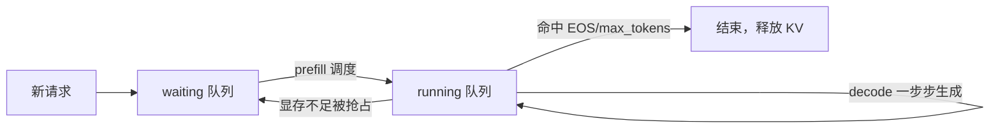
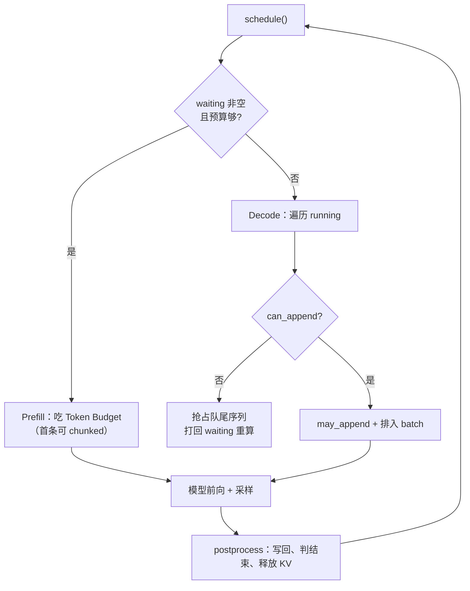

## 📑 目录

- [1. 调度器要回答的三个问题](#1-调度器要回答的三个问题)
- [2. 两个队列与一次 schedule](#2-两个队列与一次-schedule)
- [3. Prefill 调度：吃 Token Budget](#3-prefill-调度吃-token-budget)
- [4. Decode 调度：抢占来腾地方](#4-decode-调度抢占来腾地方)
- [5. postprocess：写回与结束判定](#5-postprocess写回与结束判定)
- [总结](#-总结)
- [自我检验清单](#-自我检验清单)
- [参考资料](#-参考资料)

---

## 1. 调度器要回答的三个问题

引擎每跑一步（`step`），都要先问调度器：**这一轮算谁？是 prefill 还是 decode？它们的 KV 放得下吗？** `scheduler.py` 的全部职责就是回答这三个问题。它不碰矩阵乘法，只做「资源分配 + 批次组装」的决策。

nano-vllm 延续了早期 vLLM 的策略：**一轮要么全是 prefill、要么全是 decode，不混批**。原因在第 1 章讲过——prefill 是算力密集型（一次吃整段 prompt），decode 是访存密集型（每条序列每步只算一个 token），两者的最优 batch 形态不同，分开调度各自更高效。

## 2. 两个队列与一次 schedule

调度器维护两个双端队列（`deque`）和若干预算约束：

```python
class Scheduler:
    def __init__(self, config):
        self.max_num_seqs = config.max_num_seqs                   # 一轮最多几条序列
        self.max_num_batched_tokens = config.max_num_batched_tokens  # 一轮最多几个 token
        self.eos = config.eos
        self.block_manager = BlockManager(config.num_kvcache_blocks,
                                          config.kvcache_block_size)
        self.waiting = deque()    # 新来的、还没 prefill 的序列
        self.running = deque()    # 已 prefill、正在逐 token decode 的序列
```

一条序列的流动路径很清晰：



`schedule()` 返回 `(seqs, is_prefill)`——选中的这批序列，以及这是 prefill 还是 decode。它的逻辑是**优先 prefill**：只要 `waiting` 里有序列且预算允许，就先做 prefill；`waiting` 空了，才去 `running` 做 decode。

## 3. Prefill 调度：吃 Token Budget

Prefill 分支从 `waiting` 队头依次取序列，往一个 batch 里塞，直到撞上任一预算上限：

```python
def schedule(self):
    scheduled_seqs = []
    num_batched_tokens = 0
    while self.waiting and len(scheduled_seqs) < self.max_num_seqs:
        seq = self.waiting[0]
        remaining = self.max_num_batched_tokens - num_batched_tokens  # 剩余 token 预算
        if remaining == 0:
            break
        if not seq.block_table:                     # 首次调度：先探测前缀缓存并占块
            num_cached_blocks = self.block_manager.can_allocate(seq)
            if num_cached_blocks == -1:             # 块不够，放不下
                break
            num_tokens = seq.num_tokens - num_cached_blocks * self.block_size
        else:                                        # chunked prefill 续算：块已分配
            num_tokens = seq.num_tokens - seq.num_cached_tokens
        if remaining < num_tokens and scheduled_seqs:
            break                                   # 预算不够、且已有序列：收手
        if not seq.block_table:
            self.block_manager.allocate(seq, num_cached_blocks)
        # 允许对「本轮第一条」做 chunked prefill：只算预算内的部分
        seq.num_scheduled_tokens = min(num_tokens, remaining)
        num_batched_tokens += seq.num_scheduled_tokens
        if seq.num_cached_tokens + seq.num_scheduled_tokens == seq.num_tokens:
            seq.status = SequenceStatus.RUNNING     # 整段 prompt 算完才转 running
            self.waiting.popleft(); self.running.append(seq)
        scheduled_seqs.append(seq)
    if scheduled_seqs:
        return scheduled_seqs, True                 # is_prefill = True
    # ...否则进入 decode 分支（见第 4 节）
```

两个预算共同构成 **Token Budget**：

- 🔑 **`max_num_batched_tokens`**：一轮最多处理多少 token，主要约束 prefill（prompt 可能很长）。超了就停止往 batch 里加。
- 🔑 **`max_num_seqs`**：一轮最多多少条序列，主要约束 decode（每条只算一个 token，但条数不能无限多）。

💡 **提示**：注意 `if num_tokens > remaining and scheduled_seqs: break` 这个条件——**只有在「已经塞了至少一条序列」时，预算不够才收手**。言下之意是：如果一条超长 prompt 单独一条就超预算，而 batch 还空着，调度器会用 `min(num_tokens, remaining)` 把它**截断**，只 prefill 预算内的一段（这就是 chunked prefill，剩下的下一轮继续）。这保证了超长 prompt 不会把引擎卡死。

## 4. Decode 调度：抢占来腾地方

当 `waiting` 空了，`schedule()` 转去给 `running` 里的序列做 decode。decode 每条序列每步只 +1 个 token，最大的风险是**追加这个 token 时没有空闲块了**。nano-vllm 的处理方式是**抢占（preemption）**：

```python
    # decode 分支
    while self.running and len(scheduled_seqs) < self.max_num_seqs:
        seq = self.running.popleft()
        while not self.block_manager.can_append(seq):
            if self.running:
                self.preempt(self.running.pop())   # 牺牲队尾序列（LIFO）
            else:
                self.preempt(seq); break           # 没得牺牲了，牺牲自己
        else:
            seq.num_scheduled_tokens = 1
            seq.is_prefill = False                 # 已过 prefill，进入逐 token 生成
            self.block_manager.may_append(seq)     # 真的跨块就取新块
            scheduled_seqs.append(seq)
    assert scheduled_seqs
    self.running.extendleft(reversed(scheduled_seqs))  # 放回队头，保持顺序
    return scheduled_seqs, False                       # is_prefill = False
```

抢占做的事：

```python
def preempt(self, seq):
    seq.status = SequenceStatus.WAITING   # 打回等待队列
    seq.is_prefill = True                 # 下次要重新 prefill
    self.block_manager.deallocate(seq)    # 释放它占的所有 KV 块
    self.waiting.appendleft(seq)          # 插回队头，优先重新调度
```

📌 **关键点**：nano-vllm 的抢占策略是**重计算（recomputation）而非换出（swap）**——被抢占的序列直接丢掉 KV、打回 `waiting`，下次重新 prefill。这比把 KV 搬到 CPU 内存再搬回来（swap）实现简单得多，代价是重算一遍 prefill。因为被抢占的往往是「来得最晚」的序列（队尾 LIFO 牺牲），它积累的 KV 最少，重算成本也最小。

⚠️ **注意**：`while ... else` 这个 Python 语法容易看漏——`else` 只在 `while` 条件**自然为假**（即 `can_append` 成功）时执行。也就是说：一旦腾出了空间能追加，才走 `else` 把序列正常排进本轮 batch。

## 5. postprocess：写回与结束判定

模型算完、采样出 token 后，引擎调用 `scheduler.postprocess` 把结果写回序列并判断是否结束：

```python
def postprocess(self, seqs, token_ids, is_prefill):
    for seq, token_id in zip(seqs, token_ids):
        # 把本轮算过的 token 记为「已缓存」（chunked prefill 可能分多步）
        self.block_manager.hash_blocks(seq)
        seq.num_cached_tokens += seq.num_scheduled_tokens
        seq.num_scheduled_tokens = 0
        if is_prefill and seq.num_cached_tokens < seq.num_tokens:
            continue                          # prefill 还没算完，先不追加新 token
        seq.append_token(token_id)            # 追加采样出的新 token
        if (not seq.ignore_eos and token_id == self.eos) \
           or seq.num_completion_tokens == seq.max_tokens:
            seq.status = SequenceStatus.FINISHED
            self.block_manager.deallocate(seq)   # 结束就释放 KV
            self.running.remove(seq)
```

结束条件有两个：**命中 EOS**（且没设 `ignore_eos`）或**生成数达到 `max_tokens`**。满足任一就标记 `FINISHED`、释放 KV 块、从 `running` 移除。未结束的序列留在 `running` 里，等下一轮 decode。注意 `ignore_eos`/`max_tokens` 是 `Sequence` 的实例属性（构造时从 `SamplingParams` 摊平而来，见 3.4），不是挂在 `sampling_params` 对象上。

把这一节串起来，一次 decode step 的调度闭环就是：



## 📝 总结

- 调度器只做决策、不算矩阵：维护 `waiting`/`running` 两个 deque，`schedule()` 返回 `(seqs, is_prefill)`。
- **Prefill 优先**：`waiting` 有货就先 prefill，空了才 decode；两阶段不混批。
- **Token Budget** = `max_num_batched_tokens`（约束 prefill）+ `max_num_seqs`（约束 decode）；超长 prompt 对「本轮第一条」允许 chunked prefill 截断。
- Decode 遇到 KV 不足时**抢占队尾序列**（LIFO），采用**重计算而非换出**：打回 `waiting`、重置 `is_prefill=True`、释放 KV。
- `postprocess` 写回 token，命中 EOS 或达到 `max_tokens` 则 `FINISHED` 并释放 KV。

## 🎯 自我检验清单

- 能说清 nano-vllm 为什么把 Prefill 和 Decode 分开调度，各自的资源瓶颈是什么
- 能解释 `max_num_batched_tokens` 与 `max_num_seqs` 分别主要约束哪个阶段
- 能说明「本轮第一条序列可被 chunked prefill 截断」的条件与意义
- 能复述 decode 阶段 KV 不足时的抢占流程，并解释为什么牺牲队尾
- 能解释 nano-vllm 为什么选「重计算」而非「换出」做抢占恢复
- 能说出 `postprocess` 判定序列结束的两个条件及随后的 KV 回收动作

## 📚 参考资料

- [nano-vllm GitHub 仓库](https://github.com/GeeeekExplorer/nano-vllm)
- [Efficient Memory Management for Large Language Model Serving with PagedAttention（Kwon et al., 2023）](https://arxiv.org/abs/2309.06180)
- [Orca: A Distributed Serving System for Transformer-Based Generative Models（Yu et al., 2022）](https://www.usenix.org/conference/osdi22/presentation/yu)
- [vLLM 官方文档 - 架构概览](https://docs.vllm.ai/en/stable/design/arch_overview.html)
