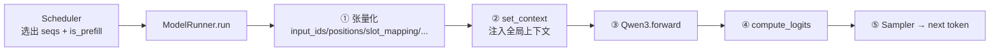
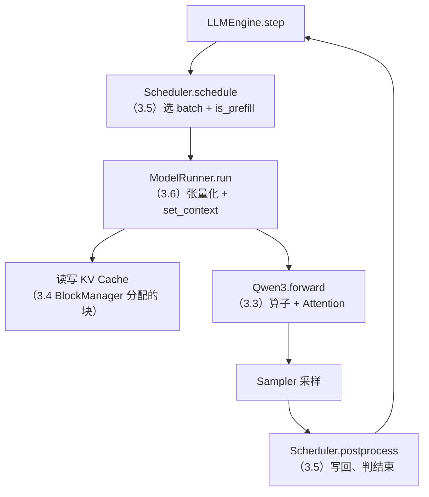

## 📑 目录

- [1. ModelRunner 的位置](#1-modelrunner-的位置)
- [2. 把序列张量化：prepare_prefill / prepare_decode](#2-把序列张量化prepare_prefill--prepare_decode)
- [3. 全局 Context：算子的"隐式参数"](#3-全局-context算子的隐式参数)
- [4. KV Cache 显存怎么切出来](#4-kv-cache-显存怎么切出来)
- [5. CUDA Graph：只为 decode 加速](#5-cuda-graph只为-decode-加速)
- [6. 张量并行的进程协同](#6-张量并行的进程协同)
- [7. 性能基准与 vLLM 对比](#7-性能基准与-vllm-对比)
- [总结](#-总结)
- [自我检验清单](#-自我检验清单)
- [参考资料](#-参考资料)

---

## 1. ModelRunner 的位置

前面几节分别讲了「算什么算子」（3.3）、「KV 放哪」（3.4）、「算谁」（3.5）。`ModelRunner`（`engine/model_runner.py`）是把它们**粘合成一次真实 GPU 执行**的那一层：它接过调度器选好的序列，构造出模型 `forward` 需要的全部张量，设置好全局上下文，调用 `Qwen3`，再把 logits 交给采样器。



## 2. 把序列张量化：prepare_prefill / prepare_decode

模型 `forward` 吃的是张量，而调度器给的是一批 `Sequence` 对象。`ModelRunner` 按阶段用两套准备函数把它们转成张量——两个阶段需要的张量形态完全不同。

**Prefill：变长序列拼在一起**

```python
def prepare_prefill(self, seqs):
    input_ids, positions, slot_mapping = [], [], []
    cu_seqlens_q, cu_seqlens_k = [0], [0]
    for seq in seqs:
        n = seq.num_scheduled_tokens              # 本轮要算的 token 数
        input_ids.extend(seq.token_ids[seq.num_cached_tokens:][:n])
        positions.extend(range(seq.num_cached_tokens, seq.num_cached_tokens + n))
        cu_seqlens_q.append(cu_seqlens_q[-1] + n) # 累积长度，供 varlen attn 切分
        cu_seqlens_k.append(cu_seqlens_k[-1] + seq.num_cached_tokens + n)
        # 逐块算出每个 token 的物理 slot
        for i in range(seq.num_cached_tokens, seq.num_cached_tokens + n):
            block = seq.block_table[i // self.block_size]
            slot_mapping.append(block * self.block_size + i % self.block_size)
    # ...转成 pin_memory 的 CUDA 张量，non_blocking 拷贝
```

- 🔑 **`cu_seqlens`（cumulative sequence lengths）**：把多条变长序列「首尾相接」后，用一串累积长度标出每条的边界，这正是 `flash_attn_varlen_func` 需要的格式（见 3.3）。
- 🔑 **`slot_mapping`**：每个 token 在 KV Cache 里的物理落点 = `物理块号 * block_size + 块内偏移`。它就是 3.3 里 Triton `store_kvcache` 按图索骥用的那张「图」。

**Decode：每条序列只有一个 token**

```python
def prepare_decode(self, seqs):
    input_ids, positions, slot_mapping, context_lens = [], [], [], []
    for seq in seqs:
        input_ids.append(seq.token_ids[-1])       # 只喂最后一个 token
        positions.append(len(seq) - 1)
        context_lens.append(len(seq))
        # 新 token 写在最后一块的下一个空位
        slot = seq.block_table[-1] * self.block_size + seq.last_block_num_tokens - 1
        slot_mapping.append(slot)
    block_tables = ... # 各序列 block_table 右侧用 -1 padding 成等长矩阵
```

- 🔑 **`context_lens`**：每条序列当前总长度，告诉 `flash_attn_with_kvcache` 要读多少历史 K/V。
- 🔑 **`block_tables` 用 -1 padding**：各序列块数不同，拼成矩阵时右侧补 -1 对齐。这也是 3.3 里 `store_kvcache` 遇到 `slot == -1` 直接 return 的由来——padding 位置不写缓存。

## 3. 全局 Context：算子的"隐式参数"

`cu_seqlens`、`slot_mapping`、`block_tables`、`is_prefill` 这些张量，Attention、LMHead 等算子都要用。如果一层层当函数参数传下去，模型代码会被污染得面目全非。nano-vllm 的做法是把它们塞进一个**全局 Context**，算子内部用 `get_context()` 现取：

```python
@dataclass
class Context:
    is_prefill: bool = False
    cu_seqlens_q: torch.Tensor = None
    cu_seqlens_k: torch.Tensor = None
    max_seqlen_q: int = 0
    max_seqlen_k: int = 0
    slot_mapping: torch.Tensor = None
    context_lens: torch.Tensor = None
    block_tables: torch.Tensor = None

def set_context(is_prefill, cu_seqlens_q=None, ...):
    global _CONTEXT
    _CONTEXT = Context(is_prefill, cu_seqlens_q, ...)
```

其中 `max_seqlen_q`/`max_seqlen_k` 是 `flash_attn_varlen_func` 需要的「本批最长序列长度」，与 `cu_seqlens` 配套使用（见 3.3 的 prefill 路径）。

💡 **提示**：这是一种「用全局变量换代码整洁」的权衡。好处是 `Qwen3.forward` 的签名干净（只有 `input_ids`、`positions`）；代价是算子对全局状态有了隐式依赖，必须保证每次 `forward` 前 `set_context` 已正确设置。在单进程、串行执行的推理循环里，这个权衡是划算的。

## 4. KV Cache 显存怎么切出来

第 2 节的 `slot_mapping` 指向的物理显存，是在引擎启动时一次性分配好的。`ModelRunner` 不按「最大长度」预留，而是**先加载权重、warmup 测峰值，再把剩下的显存全切成 KV 块**——这正是 3.2 里 `num_kvcache_blocks = -1` 要在运行时才算出的原因。

```python
def allocate_kv_cache(self):
    free, total = torch.cuda.mem_get_info()
    used = total - free                                   # 当前已占用
    peak = torch.cuda.memory_stats()["allocated_bytes.all.peak"]      # warmup 峰值
    current = torch.cuda.memory_stats()["allocated_bytes.all.current"]
    block_bytes = 2 * num_layers * block_size * num_kv_heads * head_dim * dtype_size
    # 预算 = 总配额 − 已用 − (峰值 − 当前)，为 warmup 的瞬时峰值留出余量
    num_blocks = int(total * gpu_memory_utilization - used - peak + current) // block_bytes
    # 一个 6 维大张量装下所有层、所有块的 K 和 V
    kv_cache = torch.empty(2, num_layers, num_blocks, block_size, num_kv_heads, head_dim)
    for layer_id, module in enumerate(all_attention_layers):
        module.k_cache = kv_cache[0, layer_id]            # 绑定到每层 Attention
        module.v_cache = kv_cache[1, layer_id]
```

📌 **关键点**：KV Cache 是一个 **6 维张量** `(2, 层数, 块数, 块大小, KV头数, head_dim)`——第 0 维的 2 区分 K 和 V。分配后把每一层的切片**绑定**回对应 Attention 模块的 `k_cache`/`v_cache` 属性，于是 3.3 里 `store_kvcache` 和 `flash_attn_with_kvcache` 直接拿 `self.k_cache` 就能读写。这种「先用后留」的策略是高显存利用率的来源：空出来的显存几乎全给了 KV，能容纳的并发请求因此最大化。

## 5. CUDA Graph：只为 decode 加速

Decode 阶段每步只算一个 token，GPU kernel 很小、很多，**CPU 发射 kernel 的开销（launch overhead）反而成了瓶颈**——GPU 还没算完一个小 kernel，就得等 CPU 把下一个发过来。CUDA Graph 把「一连串 kernel 发射」录制成一张图，之后一次 `replay()` 就重放整串，省掉逐个发射的 CPU 开销。

nano-vllm 只在 **decode** 阶段用 CUDA Graph，并且在启动时**预先捕获**好一批固定 batch size 的图：

```python
def capture_cudagraph(self):
    graph_bs = [1, 2, 4, 8] + list(range(16, max_bs + 1, 16))  # 预设的 batch 档位
    for bs in reversed(graph_bs):
        # 用静态输入缓冲区捕获一张图，大图的内存池共享给小图
        graph = torch.cuda.CUDAGraph()
        set_context(False, ...)                 # decode context
        with torch.cuda.graph(graph, self.graph_pool):
            outputs = self.model(input_ids[:bs], positions[:bs])
        self.graphs[bs] = graph
```

运行时按实际 batch 大小挑一张「不小于它」的图来回放：

```python
def run_model(self, input_ids, positions, is_prefill):
    if is_prefill or self.enforce_eager or input_ids.size(0) > 512:
        return self.model.compute_logits(self.model(input_ids, positions))  # 普通 eager
    bs = input_ids.size(0)
    graph = self.graphs[next(x for x in self.graph_bs if x >= bs)]  # 选最接近的档位
    # 把真实输入拷进静态缓冲区（多出来的位置用 -1 / 0 填充）
    self.graph_vars["input_ids"][:bs] = input_ids
    self.graph_vars["slot_mapping"].fill_(-1)
    self.graph_vars["slot_mapping"][:bs] = context.slot_mapping
    graph.replay()
    return self.model.compute_logits(self.graph_vars["outputs"][:bs])
```

三个要点：

- 🔑 **只捕获 decode**：prefill 的输入形状（token 总数）每次都变，没法用固定图；decode 每条序列恒定 1 token，只有 batch size 变，所以预捕获几档 batch size 就能覆盖。
- 🔑 **预设 batch 档位 + 向上取整**：`[1,2,4,8,16,32,...]` 这些档位，实际 batch 不是档位时就选「不小于它的最近档位」，多出来的位置用 padding（`slot_mapping` 填 -1、`context_lens` 填 0）。这也呼应了 3.3 `store_kvcache` 对 `slot == -1` 的跳过。
- 🔑 **`enforce_eager` 关闭它**：3.2 的 Config 里 `enforce_eager=True` 会让 `run_model` 永远走 eager 分支——调试时打开，用真实 kernel 发射方便定位问题；生产跑吞吐时关掉，让 CUDA Graph 生效。

⚠️ **注意**：`input_ids.size(0) > 512` 时也退回 eager——超大 batch 不在预捕获档位里，直接普通执行。

## 6. 张量并行的进程协同

3.2 提过，`LLMEngine` 用 `spawn` 为 `rank>0` 启动了 worker 子进程。这些子进程里跑的也是 `ModelRunner`，它们和主进程（rank 0）如何同步？nano-vllm 用**共享内存 + Event 栅栏**做了一套极简 RPC：

```python
def call(self, method_name, *args):
    # rank0 把「方法名 + 参数」写进共享内存，置位 Event 通知各 worker
    if self.world_size > 1:
        self.write_shm(method_name, args)
        for event in self.events: event.set()
    return getattr(self, method_name)(*args)   # rank0 自己也执行

def loop(self):   # rank>0 的 worker 循环
    while True:
        method_name, args = self.read_shm()    # 等 Event、读共享内存
        getattr(self, method_name)(*args)
        if method_name == "exit": break
```

📌 **关键点**：rank 0 是「指挥」——它调度、采样、持有分词器；rank 1..N-1 是「执行副本」，只负责自己那片权重的前向，通过 3.3 讲的 `all_reduce`/`gather` 和 rank 0 汇合结果。`call("run", seqs, is_prefill)` 这一个入口（3.2 的 `step` 里见过）就同时驱动了所有 rank 跑同一步。

## 7. 性能基准与 vLLM 对比

nano-vllm 仓库给出了一组和 vLLM 的吞吐对比。测试配置与结果如下（截至 2026-10 的 README 数据）：

| 📊 项目 | 配置 |
|---------|------|
| 硬件 | RTX 4070 Laptop（8GB 显存） |
| 模型 | `Qwen3-0.6B` |
| 请求数 | 256 条序列 |
| 输入/输出长度 | 各在 100–1024 之间随机 |

| 引擎 | 输出总 token | 耗时 | 吞吐 |
|------|-------------|------|------|
| vLLM | 133,966 | 98.37 s | 1361.84 tok/s |
| **nano-vllm** | 133,966 | **93.41 s** | **1434.13 tok/s** |

✅ **怎么看这个结果**：在这个小模型 + 单卡的特定场景下，nano-vllm 的吞吐略高于 vLLM。但这**不代表 nano-vllm 更强**——它赢在「没有生产框架的那些额外开销」（复杂调度、多模型抽象、API 层、各种边界处理）。换成大模型、长上下文、高并发、多卡的真实生产负载，vLLM 的工程深度就会体现出来。

❌ **不要据此得出「nano-vllm 比 vLLM 快」的结论**——这是面试里典型的误读。正确的表述是：*nano-vllm 用最小实现达到了可比的吞吐，证明它的主干算法（PagedAttention、连续批处理、FlashAttention、CUDA Graph）是「真货」，而非玩具。*

把全章的六节连起来，一次 `step` 的完整调用链就闭合了：



## 📝 总结

- `ModelRunner` 是执行层的粘合剂：张量化序列 → `set_context` → `Qwen3.forward` → `compute_logits` → 采样。
- Prefill 用 `cu_seqlens` 把变长序列拼接、`slot_mapping` 定位物理槽位；Decode 每条只喂一个 token、`block_tables` 用 -1 padding。
- 全局 `Context` 让算子通过 `get_context()` 隐式拿到调度信息，保持模型 `forward` 签名干净。
- KV Cache 是一个 6 维大张量 `(2, 层, 块, 块大小, KV头, head_dim)`，启动时按「总配额 − 权重 − warmup 峰值」切块并绑定到每层 Attention。
- CUDA Graph 只在 decode 捕获、按 batch 档位向上取整回放，`enforce_eager` 可关闭；它解决的是 decode 小 kernel 的发射开销。
- 张量并行靠「共享内存 + Event」驱动所有 rank 跑同一步，rank 0 指挥、其余执行。
- 官方基准（RTX 4070 8GB、Qwen3-0.6B）nano-vllm 吞吐略高于 vLLM，但这只说明主干算法扎实，不代表能替代 vLLM 上生产。

## 🎯 自我检验清单

- 能说出 `ModelRunner.run` 的五个步骤
- 能解释 prefill 的 `cu_seqlens`/`slot_mapping` 与 decode 的 `context_lens`/`block_tables` 各自的作用
- 能说明全局 `Context` 的设计权衡（整洁 vs 隐式依赖）
- 能复述 KV Cache 6 维张量的各维含义，以及「先加载权重再切 KV」为何能提高显存利用率
- 能解释 CUDA Graph 为什么只用于 decode、为什么要按 batch 档位 padding、`enforce_eager` 的作用
- 能描述张量并行里 rank 0 与 worker 的分工及同步机制
- 能正确解读官方基准，避免「nano-vllm 比 vLLM 快」的误读

## 📚 参考资料

- [nano-vllm GitHub 仓库](https://github.com/GeeeekExplorer/nano-vllm)
- [NVIDIA 技术博客 - Accelerating PyTorch with CUDA Graphs](https://pytorch.org/blog/accelerating-pytorch-with-cuda-graphs/)
- [CUDA C++ Programming Guide - CUDA Graphs](https://docs.nvidia.com/cuda/cuda-c-programming-guide/index.html#cuda-graphs)
- [FlashAttention: Fast and Memory-Efficient Exact Attention with IO-Awareness（Dao et al., 2022）](https://arxiv.org/abs/2205.14135)
- [Efficient Memory Management for Large Language Model Serving with PagedAttention（Kwon et al., 2023）](https://arxiv.org/abs/2309.06180)
